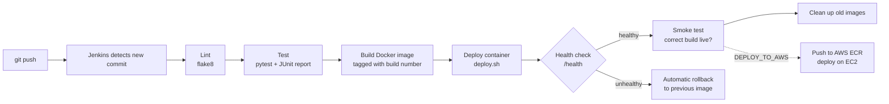

# Automated CI/CD Deployment Pipeline (Jenkins + Docker + Linux)

A complete CI/CD pipeline that **lints, tests, containerises and deploys a web application automatically every time code is pushed to Git**, with health checks, smoke tests, **automatic rollback** if a new version is broken, an optional **AWS (ECR + EC2)** deployment stage, and Linux monitoring scripts with threshold alerts.

**Tech stack:** Jenkins · Docker · Git / GitHub · Linux · Bash · AWS (ECR, EC2) · Python Flask · pytest · flake8

The application being deployed is a small **Task Manager REST API** (Python Flask). The focus of the project is the pipeline around it.

## Pipeline flow



| Stage | What happens | File |
|---|---|---|
| **Checkout** | Jenkins pulls the latest commit (polls Git every 2 minutes, or a GitHub webhook triggers it) | `Jenkinsfile` |
| **Install** | Creates a Python virtual environment and installs the app and test tools. | `app/requirements-dev.txt` |
| **Lint** | `flake8` checks code style and catches errors such as unused imports. Any problem fails the build. | `app/.flake8` |
| **Test** | Runs 7 pytest tests and publishes a JUnit report in Jenkins. A failing test stops the pipeline before anything is deployed. | `app/tests/` |
| **Build Docker Image** | Builds the image and tags it with the Jenkins build number and `latest`. The build number and Git commit are baked into the image. | `Dockerfile` |
| **Deploy** | Records the currently running image, replaces the container, waits for `/health`. If the new version never becomes healthy, it prints the logs and **rolls back** to the previous image. | `scripts/deploy.sh` |
| **Smoke Test** | Confirms `/api/version` reports the build just deployed and that the API can create a task. | `scripts/smoke_test.sh` |
| **Deploy to AWS** *(optional)* | When the build is started with `DEPLOY_TO_AWS` ticked, pushes the image to Amazon ECR and deploys it on an EC2 server with the same health check and rollback. AWS keys come from Jenkins credentials, never from Git. | `scripts/deploy_aws.sh`, `docs/aws-setup.md` |
| **Cleanup** | Deletes old image tags, keeping the newest 5 so the server disk doesn't fill up. | `scripts/cleanup_images.sh` |

## Key features

- **Fully automated:** a `git push` is all it takes to test and deploy.
- **Fail fast:** lint errors or broken tests stop the build before deployment.
- **Versioned images:** every build produces `task-manager-api:<build_number>`, so any earlier version can be redeployed.
- **Zero manual rollback:** an unhealthy deployment automatically restores the last working version.
- **Production-style container:** slim Python base image, non-root user, Docker `HEALTHCHECK`, gunicorn server, layer caching for faster builds.
- **Traceability:** the running app shows its version, Jenkins build number and Git commit at `/` and `/api/version`.
- **Linux operations scripts:** health checks, rollback, image cleanup, and a monitoring script that checks container health, the `/health` endpoint, CPU, memory and disk against thresholds, writes alerts to a log and can run from **cron** every 5 minutes.
- **Cloud-ready:** optional push to **AWS ECR** and deployment on **AWS EC2** (Mumbai region by default).
- **Secrets stay out of Git:** AWS keys and the EC2 SSH key are stored as Jenkins credentials.

## Project structure

```
ci-cd-pipeline-jenkins-docker/
├── Jenkinsfile               # the pipeline definition (8 stages)
├── Dockerfile                # application image
├── .dockerignore
├── app/
│   ├── app.py                # Task Manager REST API (Flask)
│   ├── requirements.txt      # app dependencies (in the Docker image)
│   ├── requirements-dev.txt  # + pytest and flake8 (used by Jenkins)
│   ├── .flake8
│   └── tests/test_app.py     # 7 unit tests
├── scripts/
│   ├── deploy.sh             # deploy with health check + automatic rollback
│   ├── healthcheck.sh        # waits for /health with retries
│   ├── smoke_test.sh         # verifies the right build is live
│   ├── rollback.sh           # manual rollback to any earlier build
│   ├── cleanup_images.sh     # keeps only the newest N images
│   ├── deploy_aws.sh         # push to AWS ECR + deploy on EC2
│   └── monitor.sh            # health, CPU, memory, disk checks with alerts (cron-ready)
├── docs/aws-setup.md         # step-by-step AWS setup
└── jenkins/
    ├── Dockerfile            # Jenkins + Docker CLI + Python
    └── docker-compose.yml    # runs Jenkins locally
```

## Run it yourself

**Requirements:** Docker (Docker Desktop on Mac/Windows, or Docker Engine on Linux) and Git.

### 1. Start Jenkins

```bash
cd jenkins
docker compose up -d --build
docker exec jenkins cat /var/jenkins_home/secrets/initialAdminPassword   # first-login password
```

Open http://localhost:8080, paste the password, choose **Install suggested plugins**, and create an admin user.

### 2. Create the pipeline job

1. **New Item** → name it `task-manager-pipeline` → **Pipeline** → OK.
2. Under **Pipeline**, choose **Pipeline script from SCM** → **Git**.
3. Repository URL: this repository's GitHub URL. Branch: `*/main`. Script path: `Jenkinsfile`.
4. Save, then click **Build Now**. Later builds start automatically when you push to `main`.
   After the first run, the button changes to **Build with Parameters**, where you can tick `DEPLOY_TO_AWS` (see `docs/aws-setup.md`).

### 3. See the deployed app

- App: http://localhost:8081
- Version info: http://localhost:8081/api/version
- Tasks API: http://localhost:8081/api/tasks

### Useful commands

```bash
bash scripts/monitor.sh task-manager-api 8081                          # health, CPU, memory, disk + alerts
bash scripts/rollback.sh task-manager-api 3 task-manager-api 8081      # go back to build #3
docker images task-manager-api                                          # list built versions
```

### Run the tests without Jenkins

```bash
cd app
python3 -m venv venv && source venv/bin/activate
pip install -r requirements-dev.txt
flake8 .
python -m pytest -v
```

## API (Task Manager)

| Method | Endpoint | Description |
|---|---|---|
| GET | `/health` | Health check used by Docker and the pipeline |
| GET | `/api/version` | Version, build number, Git commit, start time |
| GET | `/api/tasks` | List tasks (`?done=true/false`) |
| POST | `/api/tasks` | Create a task `{ "title": "..." }` |
| PATCH | `/api/tasks/<id>` | Update `title` or `done` |
| DELETE | `/api/tasks/<id>` | Delete a task |

### Monitoring with cron

```bash
crontab -e
# check every 5 minutes, alerts go to ~/task-manager-alerts.log
*/5 * * * * /path/to/scripts/monitor.sh task-manager-api 8081 >> /tmp/monitor.log 2>&1
```

## Possible improvements

- Add a staging environment with a manual approval step before production.
- Blue-green deployment for zero downtime.
- SonarQube code quality and Trivy image vulnerability scanning stages.
- Store task data in a database instead of memory.

## Author

**Segu Gopi Trishank**, B.Tech Computer Science, KL University (2027)
GitHub: [trishank3146](https://github.com/trishank3146) · Email: segugopi@gmail.com
